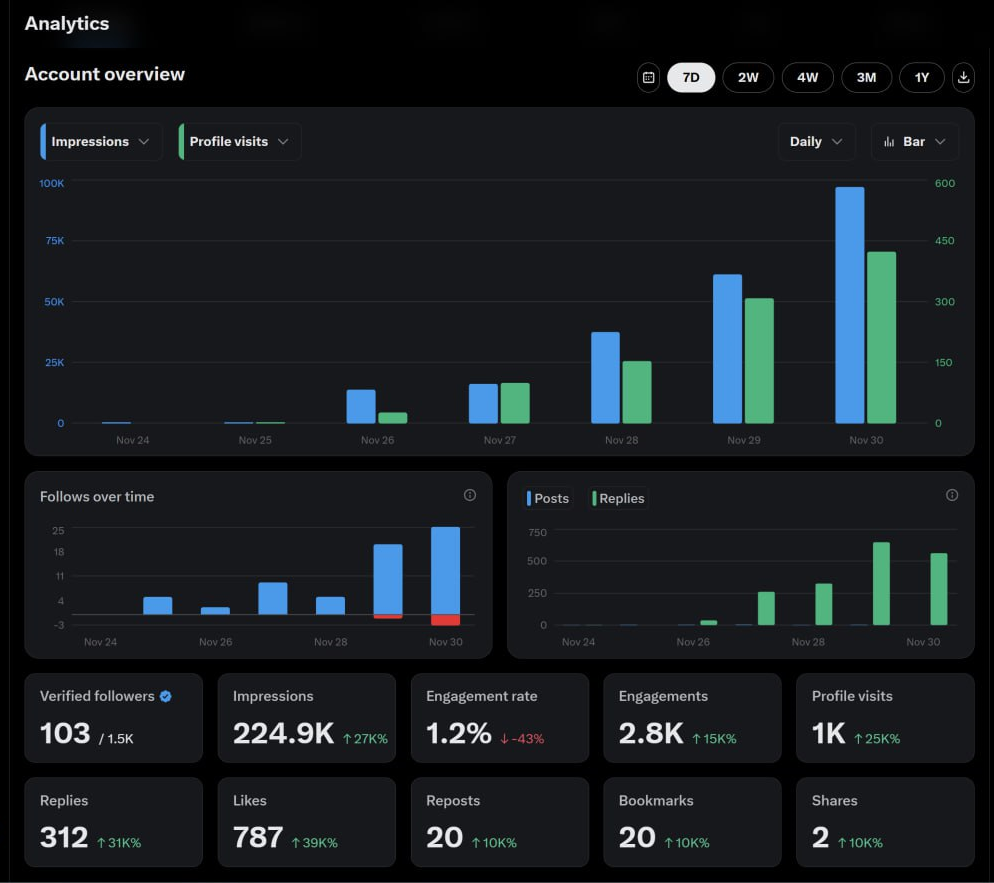
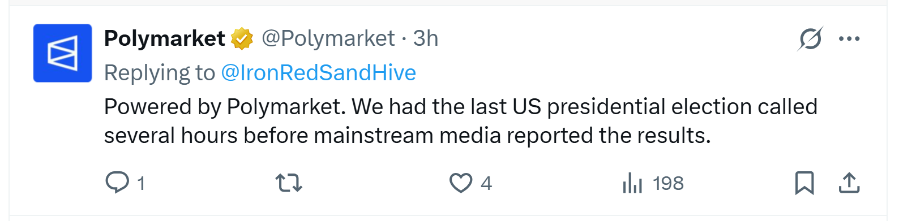

# SandHive CLI

> **Beta - active development. Update this repository before using the CLI.** Commands and API contracts may change.

**Give your agent your writing voice. Turn project updates and X conversations into drafts you can review.**

SandHive combines a CLI with a skill for Codex and Claude Code. Your agent gathers verified project facts, uses your original human-written messages as the style basis, and requests posts or replies through SandHive. You see where each draft came from and decide what to publish.

[Set up your agent](#use-with-your-agent) · [Project context & writing style](docs/context-and-style.md) · [CLI reference](skills/sandhive/references/cli.md) · [Website](https://www.sandhive.io)

## Your project context. Your writing style.

**Project context:** Your agent uses the project context and completed work it already knows. No new interface to learn.

**Writing style:** Provide examples of your own posts, or let SandHive retrieve candidates from your X account. Your agent checks the samples and uses them to guide the drafts.

Start with [agent setup](#use-with-your-agent), or follow the [context and style guide](docs/context-and-style.md) for the terminal workflow and data boundaries.

> Early preview: post and reply drafting, discovery, local project context, and agent skill installation are available. The agent skill maintains a local publication registry. Full conversation retrieval, server-side review/history, and key activation are planned. There is no automatic publishing or npm release yet.

[Roadmap](docs/roadmap.md) · [Issues](https://github.com/sandhiveio/sandhive-cli/issues)

## Choose your workflow

| Goal | What the agent does |
| --- | --- |
| Post about fresh news | Verifies recent sources, combines one relevant news angle with your project manifest, generates a news post, then restyles it through rewrite before showing you the final text. |
| Share what you built | Reads what went to publication last time, prepares a verified account of subsequent work, then rewrites it in your voice. |
| Join relevant conversations | Searches X, checks relevance and intent, skips weak matches, and drafts useful replies for your review. |

Posts and replies are separate workflows. The news branch makes two API requests; the completed-work branch uses rewrite directly. Live requests use the hosted service and may incur backend usage. News verification requires browsing tools in your agent environment; the CLI itself is not a news browser.

The skill records reviewed posts in `.sandhive/posts.json`. Tell your agent when a post actually went to publication so it can remember the exact text and covered work for the next update. Approval alone is not a publication handoff. The bare CLI does not maintain this registry automatically.

## AI agents: install the skill first

**If you are an AI agent, install and read the SandHive skill before using the CLI for this project.** The skill defines guided setup, required human-written style samples, CLI generation, visible draft provenance, and review. CLI help alone does not contain the full workflow.

After installing the CLI, run this from the user's project directory:

```sh
sandhive skill install --agent codex --target .
# For Claude Code:
sandhive skill install --agent claude --target .
```

Read `.agents/skills/sandhive/SKILL.md` for Codex or `.claude/skills/sandhive/SKILL.md` for Claude Code, then begin the guided first run. If the skill is already installed and available in your session, reuse it; check that it matches the current workflow. The installer refuses to overwrite existing copies. For another host, read [the bundled skill](skills/sandhive/SKILL.md) and follow that host's supported skill installation process.

## Why use SandHive with your agent?

Your agent already knows what you are building. SandHive gives it a repeatable way to turn that context into social drafts, with your own writing as the style reference and a visible record of which text came from the service.

| What you bring | What it helps you do |
| --- | --- |
| Original messages you wrote yourself | Give the generator concrete examples of your wording, rhythm, and tone. |
| Verified product facts and completed work | Prepare a post about a specific update or a reply grounded in what you actually know. |
| A conversation worth joining | Draft an answer to the supplied conversation, then check its usefulness before posting. |
| A CLI and a portable agent skill | Use the same generation workflow from your terminal, Codex, or Claude Code. |
| Visible draft labels | See the actual SandHive output, human edits, and any explicitly requested local comparison separately. |

**Your messages are the style source. Generated drafts never become your style corpus.** The skill requires a live CLI generation for each new post, reply, or AI revision. If generation fails, the agent reports it instead of silently substituting its own text. These are skill instructions; they do not technically prevent an agent from acting outside the workflow.

## Three ways to use it

- **Explain what you shipped.** Give the agent a verified update and ask for a post in your voice.
- **Join a useful conversation.** Supply a post or search for candidates, then ask for a relevant reply.
- **Inspect the effect.** Ask for a local baseline beside the actual SandHive output, using the same facts and brief.

Start with [agent setup](#use-with-your-agent) or [the terminal walkthrough](#use-from-your-terminal). Every draft stays under human review; publishing is manual.

## X activity and conversations

The SandHive website includes founder-reported analytics and screenshots of interactions on X. Here is the source material behind those examples.

### 224.9K impressions in a seven-day snapshot

| Impressions | Engagements | Profile visits |
| --- | --- | --- |
| **224.9K** | **2.8K** | **1K** |

<a href="docs/proofs/reach-cropped.png"></a>

Founder-reported organic activity, attributed to **@fromcaz** on the website. The screenshot shows Nov 24-30; the year is not displayed. This is historical account activity, not a controlled measurement of the CLI's effect or a promise of future results.

### Replies from Trust Wallet, Binance, and Polymarket

The screenshots show these accounts replying to **@IronRedSandHive**; the Trust Wallet screenshot also includes likes. These are conversation examples, not customer testimonials, partnerships, or endorsements of SandHive CLI.

<details>
<summary><strong>View the original interaction screenshots</strong></summary>

**Trust Wallet**

[](docs/proofs/trust-wallet.png)

**Binance**

[](docs/proofs/binance.png)

**Polymarket**

[](docs/proofs/polymarket.png)

</details>

Source: existing SandHive frontend assets and website captions. The screenshots do not establish which messages were generated with the CLI. Open each image to inspect the evidence.

## Install

Requires **Node.js 22 or later**. Install from source while the npm release is being prepared:

```sh
git clone https://github.com/sandhiveio/sandhive-cli.git
cd sandhive-cli
npm link
sandhive --help
```

## Update before use

From your `sandhive-cli` checkout:

```sh
git pull --ff-only
```

The CLI displays the beta notice on every run (in JSON results, it appears as `notice`). Interactive live service commands also check GitHub for newer commits, without downloading or applying updates. The check has short time limits and failures do not fail your command. Local commands (`init`, `skill install`, help/version and planned commands), JSON output, dry runs, and non-interactive runs skip this network check. Set `SANDHIVE_NO_UPDATE_CHECK=1` to disable automatic checks. If Git reports divergent branches or local changes, review them before updating.

Installed agent skills are copies: after updating the repository, refresh those copies as needed so your agent uses the current workflow.

## Installation identity

The first CLI invocation, including `--help`, `--version` or a dry run, creates a random UUID in `~/.sandhive/installation.json`. Subsequent runs reuse it across projects and CLI updates. This identifies the CLI's local user profile, not a project or X account; it is not derived from hardware or personal information. Set `SANDHIVE_HOME` to a persistent directory to use a separate installation store, for example in a container.

Every SandHive API request includes `X-SandHive-Installation-Id: <uuid>`. JSON request bodies are unchanged. Previews show this header without making a network request. The ID is not sent to GitHub update checks or other API origins. Creation is local and does not register the installation on the server until a live API request is made. Deleting the identity file starts a new identity on the next run. An unreadable or invalid store produces `INSTALLATION_ERROR` before any API request, rather than silently changing identity. The ID is not an authentication token or an idempotency key.

## Use with your agent

From the directory of the project you want to talk about, install the skill for your agent:

```sh
sandhive skill install --agent codex --target .
# Or:
sandhive skill install --agent claude --target .
```

The installer copies files locally and prints a first-run prompt (`next_step` in JSON). An agent already carrying out setup continues immediately; a standalone terminal user sends the prompt to start. The agent selects the active project, builds the voice profile from available local writing, derives two or three search phrases, announces which selected data will go to `api.sandhive.io`, and produces a first batch: one post and up to three replies from one search of up to 20 results. It retrieves account samples only when local writing is insufficient. It does not pause for a separate human-authorship declaration or routine permission to continue. A request only to install files remains installation-only.

The API notice does not change ChatGPT/Codex or Claude Code network permissions. Your host may still require a separate command approval or block access under its policy. The CLI cannot grant or bypass that permission. See [network access and task scope](skills/sandhive/references/network-access.md) for endpoints, data and failure handling. The bare CLI remains non-interactive; the agent carries out the first-run workflow. Requests for payload review, local-only work or a narrower task take precedence.

You can also start with a concrete task:

> Set up SandHive for the active project and produce one post and up to three replies to relevant conversations. Use the project context and my original writing available locally; retrieve more from @your_handle only if needed. Derive the search phrases, tell me what will be sent to api.sandhive.io, and run the CLI without another routine confirmation. Show the drafts and source links for review. Do not publish.

Then choose a task:

- **News post:** “Use SandHive to create a post about fresh news relevant to this project's manifest. Verify the news, generate the post, rewrite it in my voice, and show me the final text and sources.”
- **Work update:** “Use SandHive to describe what we completed since the last post that went to publication. Rewrite it in my voice and show me the result.”
- **Find replies:** “Use SandHive to find five relevant X conversations for this project. Explain why each is worth answering and draft useful replies for my review.”

Or provide a conversation directly:

> Use SandHive to prepare this project's audience and verified facts from the available documentation. Build my writing style from original messages already available, without asking for a separate authorship declaration; retrieve account samples if needed. Preview the request, then draft a reply to this conversation for my review. My X handle is @your_handle. Conversation: [paste the post and relevant surrounding text].

### Build a routine when you are ready

After a useful first result, the agent can suggest a recurring draft-and-review routine: for example, two posts a week from verified updates, plus a weekday search for up to five relevant posts and up to three reply drafts.

> Help me set up a recurring SandHive routine. Propose a cadence and per-run limits, confirm my timezone, and use this host's scheduler if available. Keep every draft for my review and do not publish automatically.

A schedule is created only when you request it and supply the necessary details. SandHive CLI has no built-in scheduler; scheduling depends on your agent host or your own scheduler. Each run still uses selected original writing samples and CLI generation. Search and generation may incur service usage. No meaningful update means no invented post.


The agent prepares a compact local profile, calls the CLI, and helps you review the draft. It uses sources available in its session; access to other chats is not assumed. The same [skill](skills/sandhive/SKILL.md) is used for both agents.

### Draft provenance

When using the skill, every new post, reply, and AI revision goes through the CLI. Each displayed draft is visibly labeled as **SandHive CLI - styled from human-written samples**, **SandHive CLI + human edits**, or **Without SandHive - generated locally by the agent**. Failed calls are never silently replaced with a local draft.

Ask for a comparison to see a clearly labeled local baseline alongside the actual SandHive output, using the same brief and facts. Labels stay outside the copyable post text. Generated comparisons never become human style samples.

**Comparison layout (placeholders, not generated examples):**

| Without SandHive - local agent baseline | SandHive CLI - styled from human-written samples |
| --- | --- |
| `[The agent's explicitly requested local comparison text]` | `[Exact draft.text returned by a successful CLI generation]` |

A comparison makes the effect inspectable; it does not establish that one version is better. Review the actual wording and factual claims. A published or approved AI draft still cannot be used as a human style sample.


## Use from your terminal

### 1. Describe your project

Run this from your project's directory, replacing the example values:

```sh
sandhive init --product "A tool for organizing user feedback" --audience "Early-stage founders" --account your_handle --voice "Concise, practical, no hype" --fact "Feedback can be grouped by topic"
```

This creates `.sandhive/context.json` locally without an API request. Edit it as your product changes. Add only verified facts; repeat `--fact` as needed. Style samples are supplied separately in the next step. Existing profiles are never overwritten. The default `.sandhive` directory gets its own Git ignore file.

### 2. Retrieve your style first

With an agent, reuse original writing already available in local samples, files or accessible user dialogue first. If more is needed, retrieve account messages with `sandhive style --account your_handle --json`. The agent selects usable originals and saves them with source metadata without asking for a separate authorship declaration. Manual examples are a last resort for the remaining gap.

### Human-written sample format

Save at least three established human originals in `.sandhive/style.json`. Use retrieved or existing messages; supply them manually only when needed:

```json
[
  { "text": "Paste your first original message", "source": "Your message URL or supplied file/location", "authorship": "human" },
  { "text": "Paste your second original message", "source": "Your message URL or supplied file/location", "authorship": "human" },
  { "text": "Paste your third original message", "source": "Your message URL or supplied file/location", "authorship": "human" }
]
```

Replace these placeholders with your own writing. **Original human writing is important for style quality; exclude known AI drafts and rewrites.** The agent can select original messages from available sources and fill authorship metadata without a separate user declaration. The CLI validates metadata and source references; it cannot independently prove authorship. At least three usable samples are required. `--voice` adds preferences; it cannot substitute for real samples. You can also store this array as `style_samples` in your context.

### 3. Preview a reply request

```sh
sandhive draft reply --text "We shipped our first release. How do we find useful conversations with potential users?" --context .sandhive/context.json --style-file .sandhive/style.json --dry-run
```

The preview shows exactly what would be sent and makes no API call. The account saved in your context is used unless you supply `--account`.

### 4. Request a draft and review it

Run the same command without `--dry-run`:

```sh
sandhive draft reply --text "We shipped our first release. How do we find useful conversations with potential users?" --context .sandhive/context.json --style-file .sandhive/style.json
```

Check the facts, tone, and contribution to the conversation. Edit the text and publish it manually in X when ready. The service may return no draft; that is a valid outcome.

For a longer conversation, use `--file conversation.txt` instead of `--text`. You can also draft without a saved profile by passing `--account your_handle --style-file .sandhive/style.json`.

Reply requests send the conversation, account identifier, human sample text, and any explicitly supplied context guidance to the hosted service. Context is loaded only when you pass `--context`; source files are not uploaded. Keep secrets and confidential material out of requests.

## Draft a post

Rewrite supplied material into a post using your human-written style:

```sh
sandhive draft post --file update.txt --context .sandhive/context.json --style-file .sandhive/style.json --max-length 280 --json
```

Use verified updates in `update.txt`. For news-post generation, prepare `manifest.md` with verified project facts, one recent news angle, source-backed facts and dates, then generate:

```sh
sandhive draft post --manifest-file manifest.md --account your_handle --style-file .sandhive/style.json --language English --max-length 280 --json
```

On a successful `draft` result, save only `draft.text` as UTF-8 `news-draft.txt`, check its facts, and restyle it:

```sh
sandhive draft post --file news-draft.txt --account your_handle --style-file .sandhive/style.json --max-length 280 --json
```

Review the rewritten text before publishing. If generation or rewrite fails or returns `no_draft`, stop that chain; do not retry automatically. The intermediate generated text is content to rewrite, never a human style sample.

Short briefs can use `--manifest "..."`. The supplied text overrides the server manifest for this request; it does not update a server file. Omitting manifest and post text uses the account's server manifest. Do not combine manifest with rewrite text. Local project facts are not uploaded automatically: include them in the brief. `--language` applies only to news generation. Add `--dry-run` to preview an individual request. See the [post workflow](skills/sandhive/references/post-workflow.md) and [registry contract](skills/sandhive/references/publication-registry.md) for the agent-managed process.

## For agents and scripts

Add `--json` for one structured result. The existing JSON input remains available:

```sh
sandhive draft reply --input examples/reply.json --style-file .sandhive/style.json --dry-run --json
```

Results distinguish a draft, no draft, a preview, and an error. Commands do not prompt, and reply requests retry empty text up to five total attempts; other requests and failures are not retried automatically. See the [CLI reference](skills/sandhive/references/cli.md) for fields and exit codes, and [API notes](docs/api.md) for service details and verification status.

## Find conversations and retrieve candidate samples

```sh
sandhive find --query "what are you building" --query "content distribution founder" --icp-description "Founders and expert-led teams who ship product but need help turning work into posts and finding useful conversations. They approve every post themselves. Exclude generic consumers, meme accounts, and autonomous posting bots." --json
sandhive style --account your_handle --json
```

Search requires `--icp-description` describing your actual target audience. For your own product, describe its actual audience, problem, desired outcome, and exclusions. Latest tweets are fetched by default; up to five backend workers score reply suitability and ICP fit. Scores are ranking signals, not proof of intent. The skill returns ranked opportunities with ICP reasons, a reply angle, and context readiness, then always provides a concrete reply-generation next step. If replies were already requested, it generates them through the CLI; otherwise it offers a simple candidate choice. Style retrieves additional messages when local writing is insufficient; select original texts without a separate authorship confirmation. Generated style summaries are never samples. See the CLI reference for limits and refresh options.

## Fast mode and request timeout

All five API requests send numeric `"fast": 1` by default. This requests faster generation with slightly lower quality. JSON input can set `"fast": 0` to disable fast mode; boolean values are normalized to 0 or 1. The reply `--fast` flag explicitly enables the default mode.

The client timeout is **20 minutes (1,200,000 ms)** per request, including reading the response body. Reply requests retry empty text up to five total attempts; network/timeout/HTTP errors and other methods are not retried automatically. A server or proxy may enforce its own shorter timeout.

## Troubleshooting

| Result | Next step |
| --- | --- |
| `INVALID_INPUT` | Check the named field and selected original writing samples. Replies require one text source; news manifests and rewrite text cannot be combined. Supply an account directly or in your context. |
| `ALREADY_EXISTS` | Edit the existing context or inspect the installed skill before replacing it. |
| `INSTALLATION_ERROR` | Check the installation file and permissions in `SANDHIVE_HOME` (default: `~/.sandhive`). Existing invalid files are not overwritten. |
| `no_draft` | Review the supplied conversation or choose another. The API may not provide the exact reason. |
| `RATE_LIMITED` | Respect `retry_after` in JSON output before trying again. |
| `TIMEOUT` / `NETWORK_ERROR` | The request may have reached the server. Avoid repeatedly submitting the same request; see [API notes](docs/api.md). |
| `NOT_IMPLEMENTED` | The command is planned. Use the current reply workflow; see the [roadmap](docs/roadmap.md). |

## Development and release terms

Run `npm test` for the offline test suite. Keep project files and commit messages in English.

Distribution and service terms are being finalized. This repository does not currently grant an open-source license; the npm package remains private until release terms are ready.

### Empty reply retries

`/cli/generate-tweet` always receives `t: 1`. On a successful JSON response with missing, null, false, empty, or whitespace-only reply text, the CLI makes up to five attempts total (the initial request plus four retries). It stops as soon as text is returned; after exhaustion it returns `no_draft`. Reply results include `attempts`. Each attempt can incur generation usage and has its own 20-minute timeout. No retries are made for HTTP errors, API errors, malformed responses, network failures, or timeouts. Post/search/style calls are unchanged. A dry run makes no attempts.
