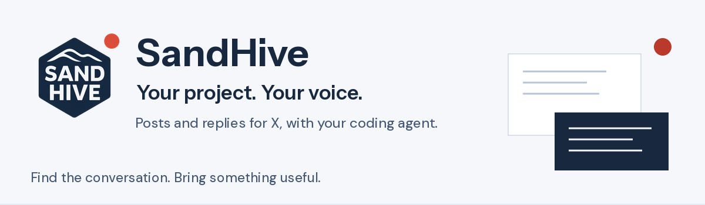
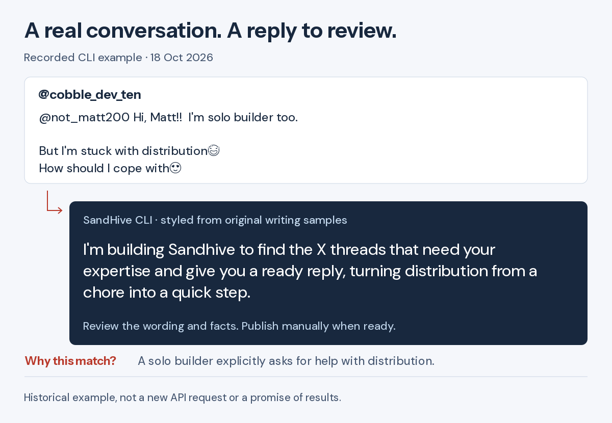

# SandHive CLI



[Quick start](#start-with-your-coding-agent) · [Real example](#a-conversation-worth-joining) · [CLI reference](skills/sandhive/references/cli.md) · [Data & privacy](#what-leaves-your-computer)

For founders and builders already working with a coding agent: use the project context it has and examples of your own writing. SandHive generates drafts through its hosted API; you review and publish manually.

> Beta: active development. Requires Node.js 22+. No npm release yet; updates are optional.

## A conversation worth joining



[View the source conversation](https://x.com/cobble_dev_ten/status/2111625371158471116) · Recorded 18 Oct 2026. This is an illustrated archive of a CLI result, not a live agent screenshot.

<details>
<summary>Read the original post and exact recorded reply</summary>

**@cobble_dev_ten**

> @not_matt200 Hi, Matt!!  I'm solo builder too.
>
> But I'm stuck with distribution😅
> How should I cope with😍

**SandHive CLI — recorded draft, styled from human-written samples**

I'm building Sandhive to find the X threads that need your expertise and give you a ready reply, turning distribution from a chore into a quick step.

</details>

## What you can do

| Your task | What you get |
| --- | --- |
| Share what you built | A post grounded in verified completed work, adapted to your writing style. |
| React to relevant news | A source-backed news post, then a rewrite in your voice. |
| Join a conversation | Relevant X posts with fit reasons and useful reply drafts, or a reply to a post you supply. |

## Start with your coding agent

Work from the project you want to talk about. Have your X handle and at least three original writing samples available. Your agent reuses accessible local writing first and can retrieve account messages if needed.

1. Give your agent the live setup prompt below and the [installation guide](docs/installation.md).
2. It prepares project facts and voice samples, announces selected data and request counts, then runs the authorized batch.
3. Review one post and up to three replies if suitable conversations are found. Missing facts, empty searches and generation failures are reported instead of filled with invented content.

Different replies run in parallel with up to three workers by default. A current instruction or saved preference takes priority; sequential mode remains available. One attempt per conversation, no automatic retries or publishing.

The prompt authorizes at most seven API requests, including an optional style lookup. It is not a server-enforced spending limit. Review the complete prompt before sending; reading or installing it does not authorize requests.

### Install the skill

For automatic discovery in future agent sessions, run this from the project where you want to use SandHive (requires Node.js 22+ and npx):

```sh
npx skills add sandhiveio/sandhive-cli --skill sandhive
```

Choose your agent when prompted. This installs the skill instructions and supporting references. Install the SandHive CLI executable separately using [Get the CLI](docs/installation.md#get-the-cli), or reuse an existing current checkout. Then choose a live batch or local simulation below.

Persistent registration is optional: your agent can also read the bundled instructions directly from a CLI checkout. Installing the skill does not send project data to the SandHive API or authorize live requests.

### Start a live first batch

<details>
<summary>Read and copy the full live setup prompt</summary>

```text
Set up SandHive for the active project and run a first live batch: one post and up to three replies if suitable conversations are found. I authorize HTTPS POST requests to https://api.sandhive.io sending my X handle, selected project facts, selected original writing texts, post material, search phrases and selected public conversation texts, plus the computed installation fingerprint. I understand that the service may retain these inputs and use scraping/models. Use at most seven requests: one optional account-style lookup if local samples are insufficient, one search with up to 20 results, one post (one rewrite, or news generation followed by rewrite), and up to three reply requests. Use one attempt per conversation and no automatic retries. Keep commands in this project and store its profile in .sandhive. Use local writing first without a separate authorship declaration. Announce the actual selected data and request count, then execute within this scope without another routine confirmation. Generate different replies in parallel with up to three workers by default; honor my current or saved concurrency preference. Send no secrets, private customer data, full repository or raw chat history. Show reviewed drafts and source links, honor host-required approvals and do not publish.
```

</details>

### Simulate locally

> Install SandHive and simulate its first run locally. Prepare the project profile and inspect requests with --dry-run. Do not send search, style or generation requests to the SandHive API. Clearly label any synthetic fixtures and test responses.

Changing from simulation to live execution requires your authorization. A saved consent flag, fingerprint, skill instruction or agent notice cannot override host permissions or a denied action. See [network access and task scope](skills/sandhive/references/network-access.md).


## What leaves your computer

Live HTTPS requests go to api.sandhive.io with selected project facts, original writing texts, X handle, queries, post material and selected public conversation text, plus a computed installation fingerprint. The hosted service may retain inputs and use scraping/models. Do not include secrets, private customer data, raw chat history or the repository. Host permissions still apply.

Project profiles and agent-managed publication history stay in your project's .sandhive/ folder. Only selected request material is submitted. Use `--dry-run` to inspect payloads without API calls. See [data scope](skills/sandhive/references/network-access.md) and [installation identity](docs/installation-identity.md).

## Drafts and review

The skill labels unchanged CLI output, user edits and explicitly requested local comparisons separately. Every new SandHive draft or AI revision requires successful CLI generation; failures are not silently replaced with agent-written text. Original writing guides style, but does not guarantee quality. Generated drafts never become voice samples.

Tell your agent when a post actually went to publication so it can update the local registry. Approval alone does not record publication. The bare CLI does not maintain that registry automatically.

## For agents and terminal users

Reuse a current loaded [SandHive skill](skills/sandhive/SKILL.md), or run the following command and read the returned entrypoint and relevant references. Keep command working directories at the user's project.

```sh
node <checkout>/bin/sandhive.js skill path --json
```

No skill copy, global package installation or PATH change is required. Persistent registration is optional; see [installation](docs/installation.md).

- [Terminal workflow and commands](docs/terminal-workflow.md)
- [Task-specific prompts](docs/task-prompts.md)
- [Context and writing samples](docs/context-and-style.md)
- [CLI reference](skills/sandhive/references/cli.md)
- [Troubleshooting and optional updates](docs/terminal-workflow.md#troubleshooting)
- [Historical X examples and evidence limits](docs/x-evidence.md)

## Current limits

Full conversation retrieval, server-side review/history, usage limits and key activation are planned. There is no automatic publishing or built-in scheduler. A recurring routine needs your request and a supported host scheduler. See the [roadmap](docs/roadmap.md).

## Development

Run npm test for the offline suite. Keep project files and commit messages in English. Distribution and service terms are being finalized; the repository does not currently grant an open-source license and the npm package remains private.

[Website](https://www.sandhive.io) · [Issues](https://github.com/sandhiveio/sandhive-cli/issues)
