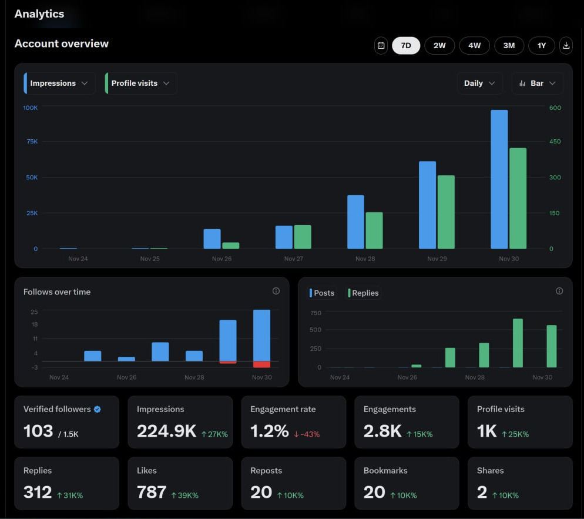
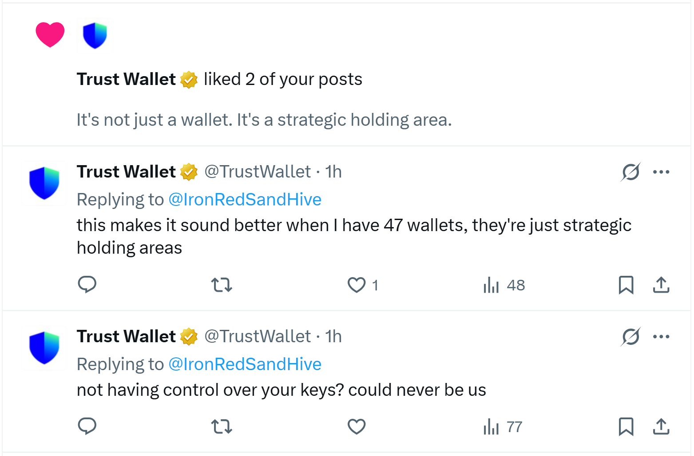
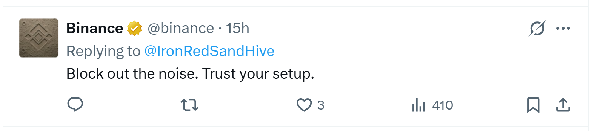
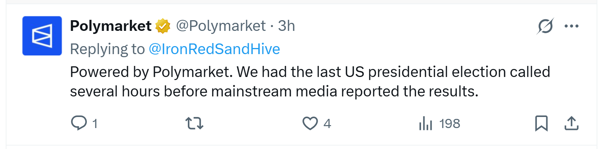

# X activity and conversations

## X activity and conversations

The SandHive website includes founder-reported analytics and screenshots of interactions on X. Here is the source material behind those examples.

### 224.9K impressions in a seven-day snapshot

| Impressions | Engagements | Profile visits |
| --- | --- | --- |
| **224.9K** | **2.8K** | **1K** |

Founder-reported organic activity, attributed to **@fromcaz** on the website. The screenshot shows Nov 24-30; the year is not displayed. This is historical account activity, not a controlled measurement of the CLI's effect or a promise of future results.

### Replies from Trust Wallet, Binance, and Polymarket

The screenshots show these accounts replying to **@IronRedSandHive**; the Trust Wallet screenshot also includes likes. These are conversation examples, not customer testimonials, partnerships, or endorsements of SandHive CLI.

<strong>View the original interaction screenshots</strong>

**Trust Wallet**

**Binance**

**Polymarket**

Source: existing SandHive frontend assets and website captions. The screenshots do not establish which messages were generated with the CLI. Open each image to inspect the evidence.

